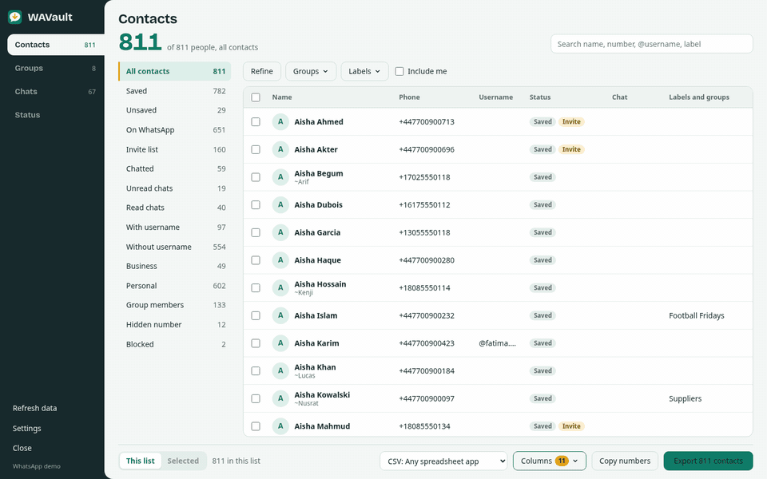
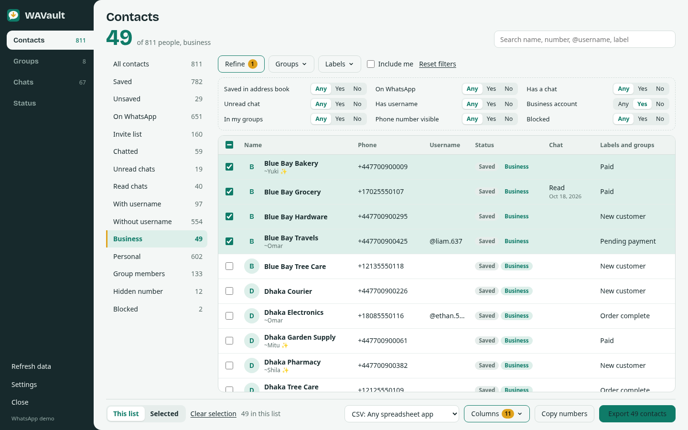
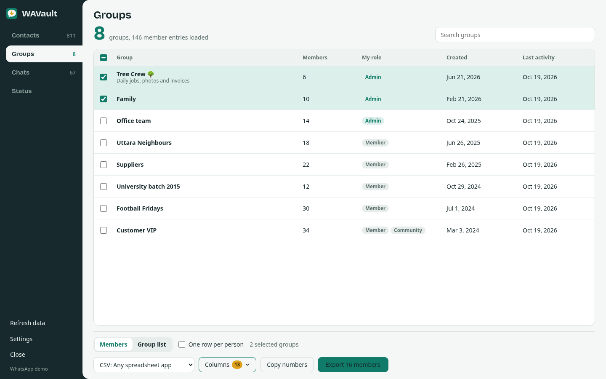
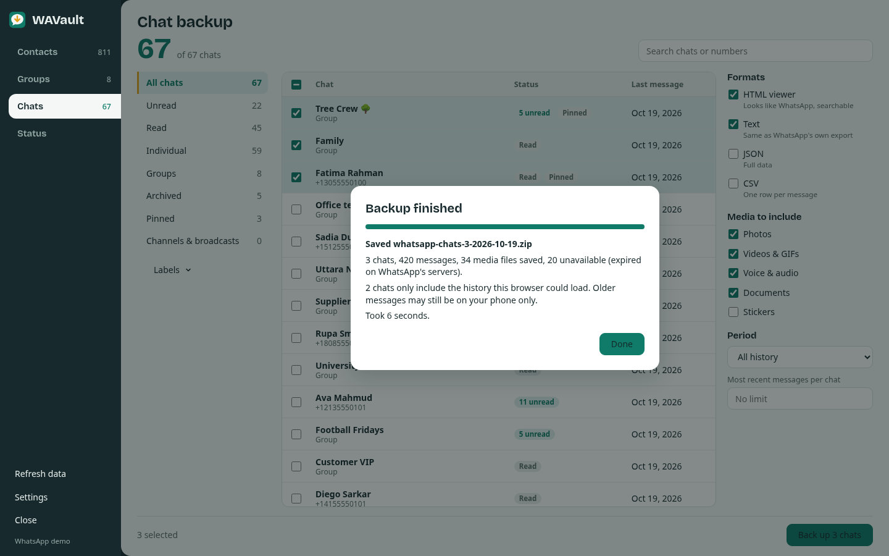
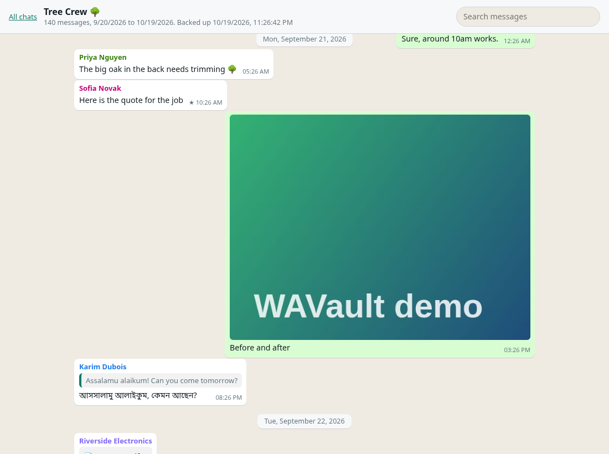
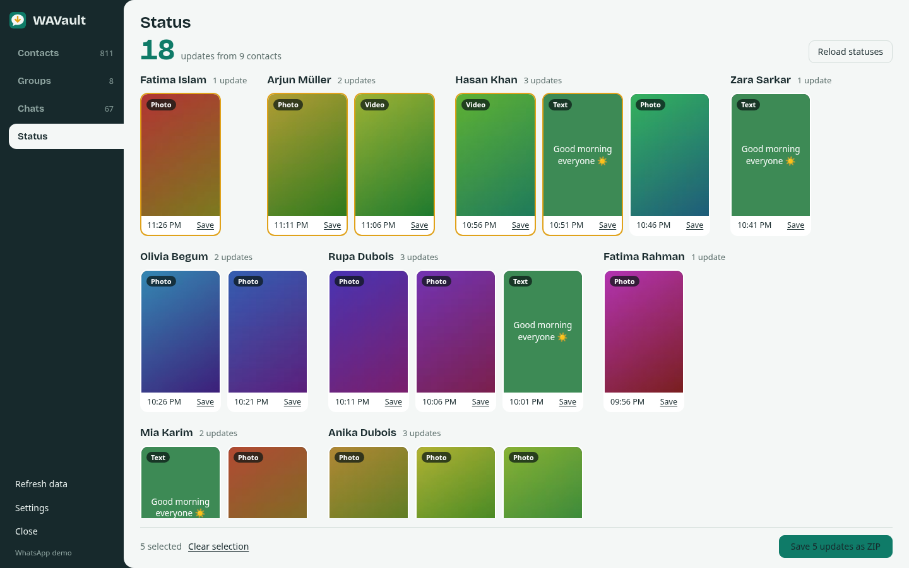
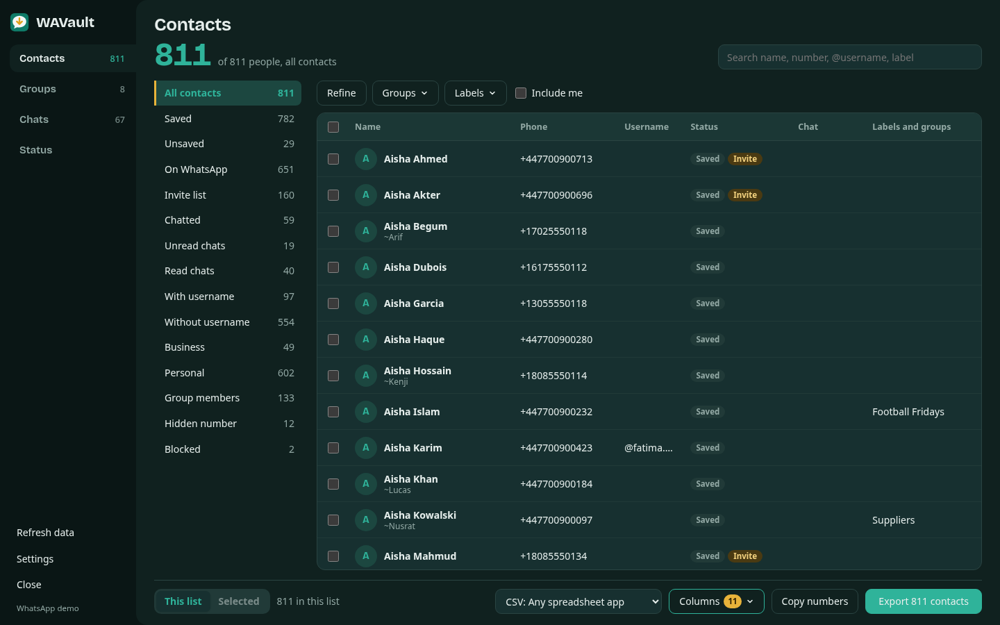
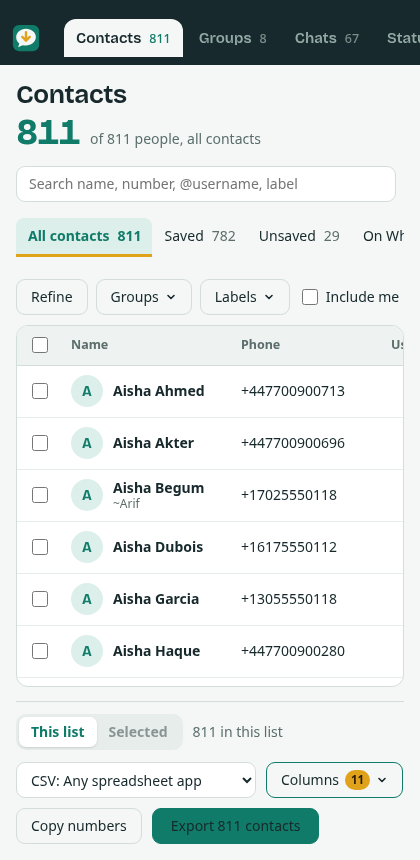

<div align="center">


# WAVault: WhatsApp Contacts Exporter, Group Members Extractor & Chat Backup

**Free, open-source browser extension for WhatsApp Web and WhatsApp Business.**<br>
Export every contact to Excel, CSV, vCard, Google Contacts or Outlook, extract group members,
back up full chats with photos and voice notes, and save statuses. Everything runs in your own browser.

[](https://github.com/md8-habibullah/wavault-whatsapp-web-backup/actions/workflows/ci.yml)
[](https://github.com/md8-habibullah/wavault-whatsapp-web-backup/releases/latest)
[](LICENSE)
[](https://github.com/md8-habibullah/wavault-whatsapp-web-backup/stargazers)


[**Download**](https://github.com/md8-habibullah/wavault-whatsapp-web-backup/releases/latest) ·
[Install guide](docs/install.md) ·
[User guide](docs/README.md) ·
[FAQ](docs/faq.md) ·
[Website](https://wavault.habibullah.dev/)



</div>

---

## The problem it solves

WhatsApp is where most of the world keeps its contacts, customers and conversations, yet it has
**no "export contacts" button**, no way to download the member list of a group, and chat export on the phone
is limited to one chat at a time, without the media in a readable form.

People feel this every day:

- **Small businesses** on WhatsApp Business need their customer list in Excel or a CRM, sorted by label
  (New customer, Paid, Pending payment).
- **Phone numbers get scattered.** Years of switching phones and syncing several devices leave contacts split
  between the address book, chats and groups, often saved twice (once by number, once by WhatsApp's private ID).
- **Community and group admins** need the member list of their groups for attendance, invitations or a mailing list.
- **Anyone switching phones or leaving WhatsApp** wants a copy of their chats they can open on a computer,
  search, and keep, with the photos and documents beside them.
- **Status updates** disappear after 24 hours, with no download button.

WAVault adds those missing buttons to WhatsApp Web. It reads only what is already loaded in your own logged-in
tab, merges the duplicates, and saves files in the formats other apps can import. Names in any script
(Bangla, Arabic, Hindi, Chinese, emoji) are kept exactly as they are.

## What you can do

| | |
|---|---|
| **Export WhatsApp contacts**<br>One clean list merged from your address book, chats and groups. 15 one-click lists (Saved, Unsaved, Invite list, Chatted, Unread, Business, With or without username, Group members, Blocked and more), Any/Yes/No filters, search by name, number in any format, @username, label or group. Export everything or only the rows you tick. |  |
| **Extract WhatsApp group members**<br>Every group with member count, your role, creation date and last activity. Export members of one, several or all groups, with each member's role (Owner, Admin, Member). In Excel you get one sheet per group. |  |
| **Back up WhatsApp chats with media**<br>Choose chats, formats, media types and a period. WAVault loads the history page by page, decrypts photos, videos, voice notes and documents, and saves a ZIP with a folder per chat. |  |
| **Read your backup like WhatsApp**<br>The HTML viewer shows bubbles, replies, dates, photos inline and a search box. It works offline in any browser, on any computer, forever. |  |
| **Download WhatsApp statuses**<br>All current status updates grouped by contact. Save one, or select several and save a ZIP with a gallery page. |  |

Dark mode follows WhatsApp's own setting, and the layout works on narrow windows too.

<p align="center">
  
  &nbsp;
  
</p>

## Export formats

**Contacts and group members**

| Format | Use it for |
|---|---|
| **Excel (.xlsx)** | Excel, Google Sheets, LibreOffice, Numbers. Numbers stay text and keep their `+`. One sheet per group for group members |
| **CSV** | Any spreadsheet or CRM. UTF-8 with BOM, so non-Latin names open correctly in Excel |
| **Google Contacts CSV** | contacts.google.com → Import. Adds a "WhatsApp" label so you can find them |
| **Outlook CSV** | Outlook.com, Outlook desktop, Microsoft 365 → Import contacts |
| **vCard 3.0 (.vcf)** | Android, iPhone, iCloud and almost every contact app |
| **vCard 4.0 (.vcf)** | Newer contact apps (RFC 6350) |
| **JSON** | Developers and automation; selected columns plus the full record |
| **Numbers list (.txt)** | One `+number` per line, de-duplicated |
| **HTML table** | A searchable page you can open anywhere |
| **PDF** | A print-ready page; choose "Save as PDF" |

You choose the columns (20 for contacts, including saved name, WhatsApp profile name, business name, username,
labels, groups, last chat, and a `wa.me` link). Spreadsheet formula injection is neutralised, so a contact named
`=HYPERLINK(...)` cannot run code in Excel.

**Chats:** HTML viewer, Text (the same layout as WhatsApp's own "Export chat", so chat-analysis tools can read it),
JSON and CSV. **Statuses:** the original photos and videos, a gallery page and a `manifest.json`.

Full details: [docs/formats.md](docs/formats.md).

## Install

### Easiest: download the ready-made package

1. Open the [latest release](https://github.com/md8-habibullah/wavault-whatsapp-web-backup/releases/latest)
   and download the zip for your browser (`chrome` also works for Brave, Opera, Vivaldi and Arc).
2. Unzip it into a folder you will keep (the browser loads the extension from that folder).
3. Load it:

| Browser | Steps |
|---|---|
| **Chrome, Brave, Opera, Vivaldi, Arc** | Open `chrome://extensions` (Brave: `brave://extensions`, Opera: `opera://extensions`) → turn on **Developer mode** → **Load unpacked** → pick the unzipped folder |
| **Microsoft Edge** | Open `edge://extensions` → turn on **Developer mode** → **Load unpacked** → pick the unzipped `edge` folder |
| **Firefox 140+** | Open `about:debugging#/runtime/this-firefox` → **Load Temporary Add-on** → pick `manifest.json` inside the unzipped `firefox` folder. Temporary add-ons are removed when Firefox closes; see the [install guide](docs/install.md#firefox) for a permanent install |
| **Safari (macOS, iOS)** | Needs a Mac with Xcode: [build steps](docs/install.md#safari) |

4. Open [web.whatsapp.com](https://web.whatsapp.com), log in, and click the **WAVault** tab on the right edge of the page
   (or the WAVault icon in the toolbar).

Store listings (Chrome Web Store, Edge Add-ons, Firefox Add-ons) are on the [roadmap](#roadmap).
Until then, the release zips are the official builds.

### From source

```bash
git clone https://github.com/md8-habibullah/wavault-whatsapp-web-backup.git
cd wavault-whatsapp-web-backup
npm ci
npm run build:all        # .output/chrome-mv3, edge-mv3, firefox-mv2, safari-mv2
```

Node.js 20 or newer. Then load the folder from `.output/` as in the table above.

## How to use it

1. **Open WhatsApp Web** and wait until your chats appear.
2. **Click the WAVault tab** on the right edge. The dashboard opens over WhatsApp with four sections:
   Contacts, Groups, Chats and Status.
3. **Pick what you want:**
   - *Contacts*: click a list on the left (for example **Unsaved** or **Business**), add filters with **Refine**,
     **Groups** or **Labels**, and search. Tick rows if you only want some.
   - *Groups*: click **Load member lists** once, tick the groups you want, choose **Members** or **Group list**.
   - *Chats*: tick chats, choose formats, media types and a period, then **Back up**.
   - *Status*: click the updates you want, then **Save as ZIP**, or **Save** on a single one.
4. **Choose a format and export.** Your browser saves the file to your Downloads folder.

Step-by-step guides with screenshots:
[Export contacts](docs/contacts.md) ·
[Import into Google, Outlook, iPhone, Android](docs/contacts.md#import-the-file-into-another-app) ·
[Export group members](docs/groups.md) ·
[Back up chats](docs/chat-backup.md) ·
[Download statuses](docs/status.md) ·
[Troubleshooting](docs/troubleshooting.md)

## Privacy

- **Nothing leaves your computer.** WAVault has no server, no analytics, no tracking and no remote code.
  Files are created inside the WhatsApp tab and saved by your browser.
- **Read-only.** It never sends messages and never changes your chats, contacts or groups.
- **Minimal permissions:** access to `https://web.whatsapp.com/*` only, plus `storage` to remember your
  format, column and theme choices.
- **Open source**, so anyone can check this. Read the [privacy policy](PRIVACY.md).

## FAQ

<details>
<summary><b>How do I export all my WhatsApp contacts to Excel or CSV?</b></summary>

Open WhatsApp Web, open WAVault, stay on **All contacts**, choose **Excel** or **CSV** in the format menu and click
**Export**. Pick a list such as **Saved** or **Business** first if you only want some of them.
[Full guide](docs/contacts.md).
</details>

<details>
<summary><b>Can I export the members of a WhatsApp group, even if I am not an admin?</b></summary>

Yes, for every group you are a member of. Open **Groups**, click **Load member lists**, tick the groups and export.
Some groups hide members' phone numbers (WhatsApp's privacy setting for large groups and communities); those members
are shown as "Hidden number".
</details>

<details>
<summary><b>How do I move WhatsApp contacts into Google Contacts, iPhone or Outlook?</b></summary>

Export with **Google Contacts**, **vCard 3.0** or **Outlook** format, then import the file in that app.
[Step-by-step import guide](docs/contacts.md#import-the-file-into-another-app).
</details>

<details>
<summary><b>Does it work with WhatsApp Business?</b></summary>

Yes. It was built on a WhatsApp Business account. Business labels show up as filters and as a column, and
business profile names are exported.
</details>

<details>
<summary><b>Can it back up chats that are older than what WhatsApp Web shows?</b></summary>

It loads everything WhatsApp Web can load, the same way scrolling up does. Very old messages that your phone never
synced to WhatsApp Web cannot be fetched; the backup marks those chats as "partial history".
</details>

<details>
<summary><b>Is it safe? Can my account be banned?</b></summary>

WAVault only reads data your own WhatsApp Web tab already has, and it sends nothing. It does not automate messaging,
which is what WhatsApp's anti-spam systems look for. It is still an unofficial tool, so use it for your own backups.
</details>

More answers: [docs/faq.md](docs/faq.md).

## Roadmap

- [ ] Chrome Web Store, Microsoft Edge Add-ons and Firefox Add-ons listings
- [ ] Scheduled automatic backups
- [ ] Incremental chat backups (only new messages since the last backup)
- [ ] Export to Google Sheets directly
- [ ] Translations of the interface (Bangla first)

Have an idea? [Open a feature request](https://github.com/md8-habibullah/wavault-whatsapp-web-backup/issues/new/choose).

## Development

```bash
npm ci
npm run dev            # Chrome with live reload
npm run dev:firefox    # Firefox with live reload
npm test               # 34 unit tests: contact merge, filters, every exporter, chat formats, backup jobs
npm run preview        # dashboard with fictional demo data at http://127.0.0.1:4789, no login needed
npm run lint:firefox   # Mozilla's add-on linter on the Firefox build
npm run screenshots    # regenerate the images in docs/images from the demo
```

Built with [WXT](https://wxt.dev), React 19 and [fflate](https://github.com/101arrowz/fflate), in plain JavaScript.
How it works, and where to fix things when WhatsApp updates: [docs/architecture.md](docs/architecture.md).
Contributions are welcome. Start with [CONTRIBUTING.md](CONTRIBUTING.md).

## Disclaimer

WAVault is an independent open-source project. It is **not affiliated with, endorsed by or sponsored by
WhatsApp or Meta Platforms, Inc.** "WhatsApp" is a trademark of its owner and is used here only to describe
what the extension works with. WAVault reads WhatsApp Web's internal data; a WhatsApp update can break a feature
until WAVault is updated. Use it for your own account and respect other people's privacy and the laws where you live.

## License

[MIT](LICENSE) © [MD. Habibullah Sharif](https://habibullah.dev)

If WAVault saved you time, a ⭐ on GitHub helps other people find it.
