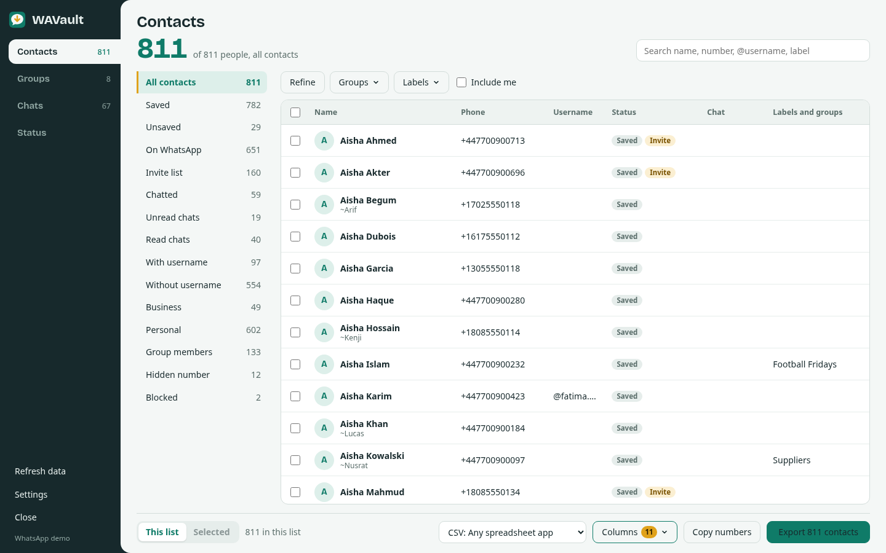

# WAVault user guide

WAVault is a free browser extension that adds backup and export tools to WhatsApp Web and WhatsApp Business Web.
These guides walk through every feature.

| Guide | What it covers |
|---|---|
| [Install](install.md) | Chrome, Edge, Brave, Opera, Vivaldi, Arc, Firefox and Safari, from a release zip or from source |
| [Export contacts](contacts.md) | Lists, filters, search, choosing rows and columns, and importing the file into Google Contacts, Outlook, iPhone or Android |
| [Export group members](groups.md) | Loading member lists, exporting one or many groups, roles, hidden numbers |
| [Back up chats](chat-backup.md) | Choosing chats, formats, media and a period; what is inside the ZIP; reading the backup |
| [Download statuses](status.md) | Saving one status or many as a ZIP |
| [Export formats](formats.md) | Every format and column in detail |
| [FAQ](faq.md) | Common questions |
| [Troubleshooting](troubleshooting.md) | What to do when something does not work |
| [How it works](architecture.md) | For developers: architecture and where to fix things after a WhatsApp update |

## The dashboard at a glance

- **Left rail:** the four sections (Contacts, Groups, Chats, Status) with counts, plus **Refresh data**,
  **Settings** (theme, launcher tab) and **Close**. The bottom line shows the WhatsApp Web version.
- **Lists column:** one-click lists with live counts.
- **Table:** tick the box at the start of a row to select it; the box in the header selects every row in the list.
- **Export bar** at the bottom: what to export (this list or selected rows), the format, the columns, and the
  export button.

Open it with the **WAVault** tab on the right edge of WhatsApp Web, the toolbar icon, or by adding
`#wavault=contacts` (or `groups`, `chats`, `status`) to the WhatsApp Web address. Press **Esc** to close it.
