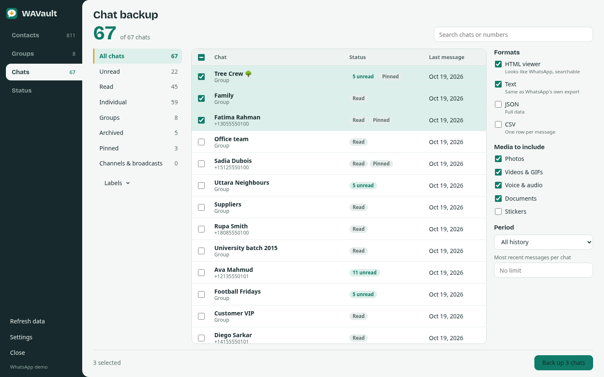
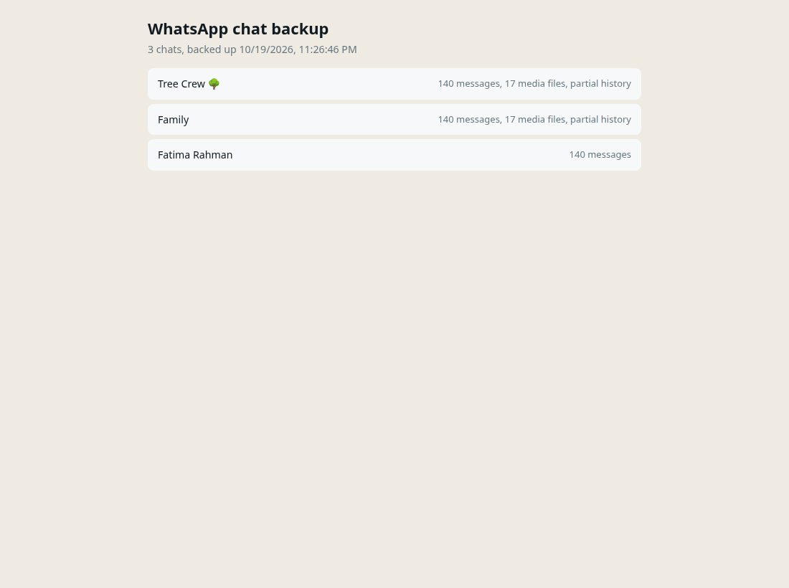

# Back up WhatsApp chats

How to back up WhatsApp chats to your computer, with photos, videos, voice notes and documents, in a format you
can read offline.



## 1. Pick chats

Open **Chats**. Use the lists on the left to narrow down:

All chats · Unread · Read · Individual · Groups · Archived · Pinned · Channels & broadcasts,
plus **Labels** (WhatsApp Business) and the search box.

Tick the chats you want. If you tick nothing, the button backs up every chat in the current list.

## 2. Choose formats

| Format | File | Best for |
|---|---|---|
| **HTML viewer** | `chat.html` | Reading. Looks like WhatsApp, with bubbles, replies, dates, photos inline and search |
| **Text** | `chat.txt` | The same layout as WhatsApp's own "Export chat" on Android, so chat-analysis tools read it |
| **JSON** | `chat.json` | Developers. Every field, including message IDs, quotes, edits, stars and media details |
| **CSV** | `chat.csv` | Spreadsheets. One row per message |

HTML and Text are selected by default.

## 3. Choose media

Photos · Videos & GIFs · Voice & audio · Documents · Stickers.

WAVault downloads and decrypts each file the same way WhatsApp Web does when you open it. Untick media types you
do not need to make the backup faster and smaller.

## 4. Choose a period (optional)

**All history**, the last 7 days, 30 days, 6 months or year, or **Since a date**. You can also limit
**Most recent messages per chat**.

## 5. Back up

Click **Back up N chats**. A progress window shows the current chat, how many messages are loaded and how many media
files are saved. Keep the WhatsApp tab open while it runs. **Stop** ends the backup and still saves the chats
finished so far.


The summary tells you exactly what happened: chats and messages saved, media saved, media that is no longer
available, and any chat with only partial history.

## What you get

One chat in one format without media is saved as a single file. Anything more is a ZIP:

```
whatsapp-chats-3-2026-10-19.zip
├── index.html                 ← start here: links to every chat
├── Tree Crew/
│   ├── chat.html
│   ├── chat.txt
│   └── media/
│       ├── 20261018-142310-image-3EB0A1F2.jpg
│       └── 20261018-150102-Quote 139.pdf
├── Family/
│   └── ...
```

Unzip it and open `index.html`. It works offline, on any computer, in any browser, and needs nothing installed.




In the viewer, type in **Search messages** to filter and highlight. Links are clickable. Dark mode follows your
computer's setting.

## Why some history or media is missing

- **History:** WhatsApp Web only has what your phone has synced to it. WAVault asks for older messages page by page,
  exactly like scrolling up. When WhatsApp has nothing older to give, the chat is marked **partial history** in the
  summary and the index page. Keeping your phone online and opening WhatsApp on it can help WhatsApp Web fetch more.
- **Media:** WhatsApp deletes media files from its servers some time after they were sent. Expired media shows as
  "not saved" in the backup, with the small preview image when WhatsApp still has one.

## Tips

- Large chats with many videos can take a while. Back up the biggest chats separately, or limit the period.
- Run a backup before you change phones or reset WhatsApp.
- A second backup of the same chats does not overwrite the first; files are named with the date.
