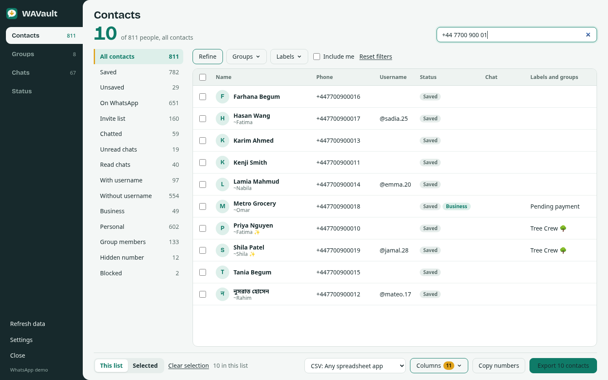

# Export WhatsApp contacts

How to export WhatsApp contacts to Excel, CSV, vCard, Google Contacts or Outlook with WAVault, and how to pick
exactly the contacts you want.

## Where the list comes from

WhatsApp keeps the same person in several places: your phone's address book, your chats, your groups, and
sometimes twice (once by phone number and once by WhatsApp's private ID, called LID). WAVault merges all of them
into **one row per person**, so the count you see is the number of real people.

Each contact can come from:

- **Address book**: numbers saved on the phone that WhatsApp synced. This includes saved numbers that are *not*
  on WhatsApp, which appear in the **Invite list**.
- **Chats**: people you have a chat with, saved or not.
- **Groups**: members of your groups (after you load member lists in [Groups](groups.md)).

The **Found in** column tells you which sources a contact came from.

## Lists

Click a list on the left. The number beside each one is how many people it contains.

| List | Who is in it |
|---|---|
| All contacts | Everyone |
| Saved | Saved in your phone's address book |
| Unsaved | On WhatsApp but not saved (people who messaged you, group members) |
| On WhatsApp | Has a WhatsApp account |
| Invite list | Saved in your address book but not on WhatsApp |
| Chatted | You have a one-to-one chat with them |
| Unread chats | Their chat has unread messages or is marked unread |
| Read chats | Their chat is fully read |
| With username | Has a WhatsApp @username |
| Without username | On WhatsApp, no username |
| Business | WhatsApp Business account |
| Personal | Regular WhatsApp account |
| Group members | In at least one of your groups |
| Hidden number | WhatsApp hides the phone number (privacy in large groups and communities) |
| Blocked | On your block list |

Your own number is left out. Tick **Include me** to add it.

## Refine with filters

Click **Refine** to combine conditions. Each one has three positions:
**Any** (ignore), **Yes** (must be true) and **No** (must be false).

Conditions: Saved in address book, On WhatsApp, Has a chat, Unread chat, Has username, Business account,
In my groups, Phone number visible, Blocked.

Examples:

- *Unsaved people who messaged me and are still unread:* Saved = No, Has a chat = Yes, Unread chat = Yes.
- *Business customers without a username:* Business account = Yes, Has username = No.

**Groups** and **Labels** narrow the list to members of the chosen groups or contacts with the chosen
WhatsApp Business labels (for example *New customer* or *Paid*). **Reset filters** clears everything.

## Search

The search box matches names in any language, profile names, business names, @usernames, labels and groups.

Phone numbers match in any format: `+44 7700 900123`, `07700900123` and `447700900123` all find the same person.

## Choose rows and columns

- **This list** exports everything in the current list. **Selected** exports only the rows you ticked.
  The header checkbox ticks every row in the list.
- **Columns** lets you choose what goes in the file (for CSV, Excel, JSON, HTML and PDF). Your choice is remembered.
  See [all columns](formats.md#contact-columns).
- **Copy numbers** copies the phone numbers of the current list (or selection) to the clipboard, one per line.

## Export

1. Choose a format in the menu at the bottom.
2. Click **Export N contacts**.
3. Your browser saves the file to your Downloads folder, named after the list and the date, for example `wavault-contacts-business-2026-10-19.xlsx`.

vCard, Google and Outlook files need a phone number, so contacts with a hidden number are skipped there.
WAVault tells you how many were skipped.

## Import the file into another app

### Google Contacts (Android phones sync from here)

1. Export with the **Google Contacts** format.
2. Open [contacts.google.com](https://contacts.google.com) → **Import** (left menu) → **Select file** → **Import**.
3. The contacts get a **WhatsApp** label, plus any WhatsApp Business labels they had.

Use **Merge and fix** in Google Contacts afterwards if some people were already there.

### iPhone and iCloud

1. Export with **vCard 3.0**.
2. Either open [icloud.com/contacts](https://www.icloud.com/contacts) → **+** → **Import Contact** → pick the `.vcf`,
   or send the `.vcf` file to your iPhone (AirDrop, email, Files) and tap it → **Add All Contacts**.

### Android without Google

1. Export with **vCard 3.0** and copy the `.vcf` file to the phone.
2. Open the **Contacts** app → **Fix & manage** (Samsung: **Manage contacts**) → **Import from file** → pick the file.

### Outlook and Microsoft 365

1. Export with the **Outlook** format.
2. **Outlook.com / new Outlook:** open **People** → **Manage contacts** (or the … menu) → **Import contacts** → pick the file.
3. **Classic Outlook for Windows:** **File** → **Open & Export** → **Import/Export** →
   **Import from another program or file** → **Comma Separated Values** → pick the file → choose the Contacts folder.

### Excel, Google Sheets, a CRM

- **Excel (.xlsx)** opens directly. Phone numbers are stored as text, so they keep their `+` and leading digits.
- For a CRM or mailing tool, **CSV** is the most widely accepted. It is UTF-8 with a byte-order mark, so names in
  Bangla, Arabic, Hindi, Chinese or with emoji display correctly in Excel.

## Tips

- Click **Refresh data** in the left rail after WhatsApp finishes syncing new chats.
- For the most complete list, load group member lists first ([Groups](groups.md)). Group members then show up in
  **Group members** and the **Unsaved** list.
- WAVault remembers your format, columns and theme in this browser.
